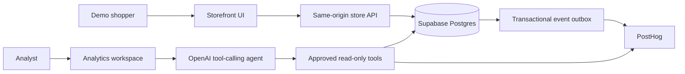

# Fieldwork · Product Experimentation Copilot

A product analytics workspace built around a working demo storefront. Shoppers
create persistent carts and orders in Supabase; PostHog collects behavioral and
server events; an analyst agent uses approved read-only tools to explain the data
and return inspectable evidence.

The **storefront and analytics workspace are separate applications**. All shoppers
and payments are fictional. The application code, SQL transactions, telemetry
pipeline, and API integrations are real.

## Current status

| Area | Implemented and verified | Still pending |
| --- | --- | --- |
| Storefront | Database-backed upgrade and A/B card variants published privately. Actual local-browser checkouts through both variants saved Supabase orders using simulated payment. | Verify checkout again in the hosted signed-in session. |
| Supabase | Dedicated development project provisioned; 15 protected tables, six demo shoppers, two products. Transaction and authorization tests pass. | Run the 2,000-shopper application-flow simulation. |
| Analytics UI | Separate dashboard, chat, evidence drawer, experiment workspace and editable PowerPoint readout. Supabase and PostHog source selection executes fresh queries and compares the results. | Continue validation with planned real traffic. |
| OpenAI agent | Funded Responses API tool-calling investigations return model explanations and inspectable evidence. The final bounded turn is reserved for an explanation. | Evaluate quality on more real analytics questions. |
| PostHog | Server-only query key configured. Fresh queries independently reproduce the persisted experiment metrics; transactional outboxes deliver commerce and experiment events. | No scheduled retry worker; delivery lag is shown as a comparison difference. |
| Experiments | Supabase-persisted assignments, exposures and session/order attribution. Live source queries, synthetic/live cohort selection, comparison, methods and screenshots. | A separately planned real-customer test and native PostHog flag integration. |

Preview the [analytics workspace](https://fieldwork-analytics-agent.bapnocap.chatgpt.site)
and the [existing storefront](https://fieldwork-checkout-lab.bapnocap.chatgpt.site).
The experiment view executes live queries against either source. The scripted
2,000-visitor fixture and live demo interactions are kept in separate datasets.
OpenAI credits are configured. The captioned walkthrough uses actual tool-backed model responses; see [demo recording and readout instructions](docs/demo/README.md).

## Ask in ordinary language

Questions such as “what products do users like most” are interpreted into measurable behavior. The agent states its assumption, compares product views and cart users, and adds persisted purchase evidence where supported. Imported event-only data supports product-interest analysis too. It asks a targeted follow-up only when a meaningful ambiguity has no reasonable default, and never silently changes the selected dataset. See [intent handling, capabilities and live checks](docs/agent-intent.md).

## Editable experiment readouts

In **Experiments**, ask an investigation question and choose **Create readout**. Review the narrative, add a reviewer and follow-up owner, and record a human decision. **Download editable PowerPoint** exports native editable text, tables and charts alongside control/variant screenshots and complete query evidence in speaker notes. **Download evidence JSON** preserves the pinned source snapshot. Drafts save in the current browser and remain unchanged when analytics refreshes. The synthetic fixture never constitutes evidence of real business lift.

## How the system works



Checkout prices come from the database, not the browser. An order, its line items,
its canonical event, and an outbox record are written in one transaction.
Idempotency keys and unique checkout constraints prevent duplicate orders.

PostHog receives the backend purchase as **`order_completed`**, with the database
order ID as `transaction_id`. Browser **`purchase`** events are a separate
behavioral stream. Reconciliation compares the identifiers; it does not add both
streams together as separate orders.

The agent cannot execute arbitrary SQL or write commerce data. It can select
approved tools for overview, device funnel, daily orders, products, channels,
order reconciliation, and synthetic experiment evidence. Each result includes its source, dataset, date boundaries,
query or RPC, returned data, and execution time. OpenAI chooses tools and explains
returned evidence; SQL and code calculate the metrics.

## Repository layout

| Path | Purpose |
| --- | --- |
| `sites/fieldwork-supply/` | Storefront UI and same-origin backend routes |
| `sites/fieldwork-agent/` | Analytics dashboard, chat and evidence inspector |
| `platform/` | Canonical shared backend, validation, sessions, telemetry and agent tools |
| `database/schema.sql` | Initial Supabase schema and transactional RPC functions |
| `scripts/simulate_shoppers.mjs` | Fictional shoppers using the real application APIs |
| `scripts/seed_posthog.py` | Earlier event-only PostHog fixture generator |
| `tests/` | Postgres transaction tests and server security checks |
| `docs/platform_build.md` | Detailed architecture, configuration and limitations |
| `app.py`, `analysis_engine.py`, `readout_deck.py` | Earlier Streamlit prototype and editable PowerPoint readouts |

The shared server modules are copied into each Site by `npm run configure`.
Edit `platform/`, not the generated copies in `sites/*/lib/platform/`.

## Local setup

Use Node **22.13 or newer**.

```sh
npm ci
npm --prefix sites/fieldwork-supply ci
npm --prefix sites/fieldwork-agent ci
```

Create a dedicated Supabase development project. Inspect its tables, then apply
`database/schema.sql` once to its empty public schema. It intentionally does not
drop existing tables. The current project has already been provisioned; do not
reapply the initial schema to it or to unrelated projects.

Copy `.env.example` to `.env` if no local environment file exists. If `.env`
already exists, preserve it and fill only the missing values.

| Variable | Used for |
| --- | --- |
| `SUPABASE_URL` | Dedicated project's API URL |
| `SUPABASE_SECRET_KEY` | Backend-only Supabase server secret |
| `SESSION_SECRET` | Random signing secret of at least 32 characters |
| `SIMULATION_TOKEN` | Random authorization token for the controlled simulator |
| `POSTHOG_HOST`, `POSTHOG_PROJECT_TOKEN` | Event ingestion |
| `POSTHOG_APP_HOST`, `POSTHOG_PROJECT_ID` | Analytics query destination |
| `POSTHOG_PERSONAL_API_KEY` | Backend-only read/query credential |
| `OPENAI_API_KEY`, `OPENAI_MODEL` | OpenAI Responses API analyst |

The OpenAI model is configured as `gpt-6.1-terra`. A valid key and model access do
not establish that API credits are available. No paid agent request is required
to run the automated tests.

```sh
npm run configure
# Generates the storefront's public ingestion configuration:
cd sites/fieldwork-supply
node build-analytics.mjs
cd ../..

# Run these in separate terminals:
npm run dev:store       # http://localhost:3001
npm run dev:analytics   # http://localhost:3000
```

Local previews use the Sites starter's simulated ChatGPT sign-in. Hosted access
uses the Site's private access policy. Demo shopper selection is a simulation,
not production customer authentication.

When no model key is configured, the chat explicitly uses **Guided analysis**.
When a configured provider fails, the application returns an error instead of
inventing an answer or silently claiming the model succeeded.

## Credentials and GitHub

**Never commit `.env`, `.dev.vars`, server keys or generated customer data.**
Only `.env.example`, containing variable names and safe example values, belongs
in GitHub. Local environment files, generated builds, dependency directories and
runtime state are ignored.

```sh
# Print whether the local environment file is ignored:
git check-ignore .env
# Scan source/build files against configured server-secret values without printing them:
node scripts/check_secrets.mjs
```

`npm run configure` writes ignored local `.dev.vars` files. Those files do not
configure production. Set hosted secrets in each Site's runtime environment, then
deploy a new saved version. The storefront does not receive the OpenAI key or
PostHog personal query key. Keep both Sites owner-private for this initial build.

The development OpenAI key was created through the secure OpenAI Developers
setup flow and saved to the developer-confirmed local environment file. It is
not included in this repository.

## Two different kinds of simulation

| Dataset | What it represents |
| --- | --- |
| `fieldwork_synthetic_2000_v1` | Earlier direct import: 2,000 profiles, 32,803 events, 5,790 visits and 1,492 simulated purchases. It contains no corresponding application order records. |
| `fieldwork_flow_v1` | New simulation that calls login, cart, checkout and payment APIs, creating persistent orders before telemetry delivery. Implemented, not yet run for all 2,000 shoppers. |
| `fieldwork_live_v2` | Manual browser and backend verification journeys in the upgraded application. Still fictional shoppers and simulated payments. |

Do not use the earlier import as proof that the new application flows work.

After configuring the backend and verifying one manual checkout, set
`STORE_BASE_URL` and run:

```sh
npm run simulate -- --users 2
npm run simulate -- --users 2000
```

The simulator uses four workers, stable shopper/session/request IDs and a local
checkpoint. Each shopper has two visits over November 9–22, 2026 UTC. A planted
scenario lowers mobile payment completion in the second week. Change the dataset
version before changing those fixed dates or generation logic.

For a private hosted storefront, the simulator also needs supported platform
service access in `STORE_SERVICE_TOKEN`. Keep it local. The simulator uses the
same business-operation handlers as the browser; it does not insert orders
straight into database tables or fabricate PostHog purchase events.

## Validation

```sh
npm test
(cd sites/fieldwork-agent && ./node_modules/.bin/tsc --noEmit)
(cd sites/fieldwork-supply && ./node_modules/.bin/tsc --noEmit)
npm --prefix sites/fieldwork-agent run build
npm --prefix sites/fieldwork-supply run build
```

Database tests run the SQL against embedded Postgres through PGlite. They check
server-calculated totals, line-item consistency, session ownership, idempotent
retries, duplicate-order prevention, outbox claiming, sign-out, and denied browser
access. Server tests check signed sessions, date/dataset bounds, approved tools,
authentication and cross-origin write rejection.

GitHub Actions runs tests, type checks and builds without live provider secrets.
Live Supabase, PostHog and OpenAI verification is reported separately from those
checks. See [hosted collection evidence](docs/live_collection_verification.md)
and the [earlier synthetic fixture audit](docs/synthetic_dataset.md).

## Current boundaries

- All customer activity and payments are simulated. This is not a real payment system.
- The workspace is single-owner, not a multi-tenant analytics service.
- PostHog retries are request-triggered or explicitly invoked; no scheduled retry worker is configured.
- Capture acceptance is not proof of stored/queryable events; reconcile against PostHog records.
- Reconciliation is limited to the latest 500 orders from each source and labels that scope.
- Date windows use UTC and an exclusive end. Funnels can truncate outcomes near the window end.
- The custom experiment includes illustrative fixed-horizon inference on a planted synthetic effect. It cannot establish real causal lift or justify a production rollout. Native PostHog flag orchestration is not implemented.
- Persistent chat history and production customer authentication are future work.

The next verification milestone is a signed-in hosted checkout, its matching
stored PostHog event, and a source-backed OpenAI investigation in that hosted session. Funded local generation and independent source queries have passed.

## Product, web analytics, and experimentation demo

The Experiments workspace compares the original product cards with direct Add to bag buttons. It includes actual before/after screenshots, a reproducible 2,000-visitor synthetic dataset (9,126 events), product funnels, device/channel segmentation, a difference interval, guardrails, and traceable read-only experiment evidence. The planted effect is explicitly labeled synthetic.

- [Experiment specification, metrics, screenshots, and reproduction](docs/experiments/quick-add.md)
- [Open experiment workspace](https://fieldwork-analytics-agent.bapnocap.chatgpt.site/?view=experiments)
- [Preview control](https://fieldwork-checkout-lab.bapnocap.chatgpt.site/?experiment_preview=A) · [Preview treatment](https://fieldwork-checkout-lab.bapnocap.chatgpt.site/?experiment_preview=B)

PostHog MCP verified all 9,126 unique synthetic event records and the exact per-variant counts. The frontend now executes fresh Supabase and PostHog queries, exposes the evidence and query time, and checks aggregate parity across both sources. No bundled result is used as fallback. This is a custom-coded A/B experiment, not a native PostHog feature flag. Preview overrides are excluded from analytics and checkout writes.

### Query-backed experiment data

The synthetic fixture is now persisted in Supabase as well as PostHog. Select **Query source** to reproduce results from either system, and **Traffic cohort** to inspect newly collected demo-store interactions. Visitor assignments, exposures and session links persist in Supabase; a trigger attributes commerce outcomes using verified order IDs and server prices. Browser event capture cannot forge purchases.

For a fresh database, apply `database/schema.sql` followed by `database/experiments.sql`. To backfill the existing synthetic fixture, run `node scripts/import_experiment_database.mjs` after generating it. The import is UUID-idempotent and does not create commerce orders. The root generator no longer creates a production-bundled result artifact. See the [experiment guide](docs/experiments/quick-add.md), [Supabase audit SQL](sql/experiment_audit.sql), and [PostHog query](sql/posthog_experiment.sql).
