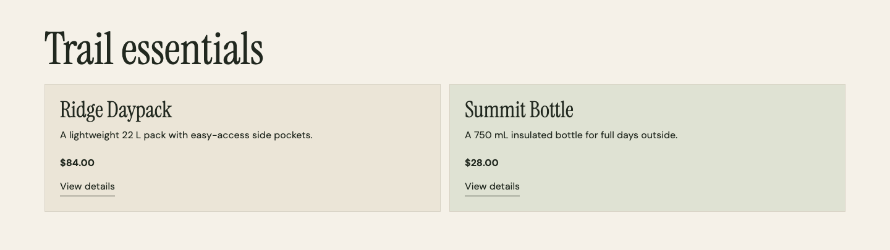
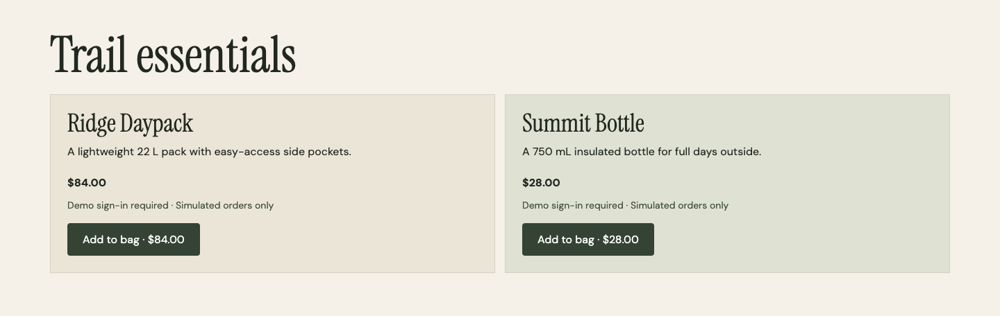

# Quick add on product cards — FW–001

This is a custom-coded storefront experiment and a reproducible synthetic demonstration, not a native PostHog feature-flag experiment. The generated effect is deliberately planted; it cannot justify shipping the treatment.

## Hypothesis and change

A direct Add to bag button on collection cards may reduce friction for signed-in demo shoppers and increase completed purchases. Control A opens product details before adding. Treatment B adds from the card and makes the demo sign-in requirement visible. Guests must still select a fictional account; treatment does not bypass sign-in, change prices, or take payment.

| Control A | Treatment B |
|---|---|
|  |  |

[Full control](screenshots/store-A.png) · [Full treatment](screenshots/store-B.png) · [Mobile treatment](screenshots/store-B-mobile.png)

## Demo evidence

Dataset: `fieldwork_experiment_2000_v1`. Fixed window: November 9, 2026 00:00 UTC through November 23, 2026 00:00 UTC, exclusive. Seed: 20261122. One visit per fictional visitor. Allocation uses a deterministic visitor hash, intended 50/50, not forced equal counts.

| Variant | Exposed visitors | Purchases | Purchase rate | Simulated revenue |
|---|---:|---:|---:|---:|
| A | 946 | 118 | 12.47% | $7,000 |
| B | 1,054 | 207 | 19.64% | $11,732 |

Difference: +7.17 percentage points, +57.45% relative. Illustrative unpooled normal 95% difference interval: +3.97 to +10.36 pp. Independent visitor, fixed-horizon assumptions; no sequential or multiplicity adjustment. The sample-ratio diagnostic uses a predeclared 0.001 threshold (chi-square > 10.82 for one degree of freedom); observed chi-square is 5.832. This demo is not a power or sample-size plan for real traffic.

The 9,126 event records were accepted by PostHog and independently queried through its MCP connection. Stored unique UUID counts match exactly: A 4,035 events / 946 exposures / 118 purchases; B 5,091 / 1,054 / 207. These are scripted records, not 2,000 browser sessions, Supabase order rows, replay recordings, or real customers. Re-running upload resumes by deterministic UUID and a local checkpoint.

[Analytics results screenshot](screenshots/analytics-results.png) · [Change comparison](screenshots/analytics-changes.png) · [Web and product analytics](screenshots/analytics-funnel.png) · [Mobile results](screenshots/analytics-mobile.png)

## Metrics and attribution

- Primary: unique exposed visitors with purchase after first exposure / unique exposed visitors, inside the fixed horizon.
- Product: product engagement, any shopping CTA engagement, cart additions, checkouts, purchase funnel, simulated gross revenue.
- Web: device and acquisition-channel segments; custom no-product-engagement proportion. This is not PostHog native session bounce rate.
- Guardrail: visitors with payment_error / visitors starting checkout. Errors are synthetic. Performance, latency, retention, repeat visits, refunds, and real payment reliability were not measured.
- Segments are exploratory and not separately powered; no multiple-comparison correction.

## Live implementation

The browser stores an anonymous experiment visitor UUID in localStorage and assigns a stable A/B variant. Assignment stays the same when selecting a demo account. Clearing storage or using another browser/device creates a new unit; no cross-device identity resolution is claimed. If storage is unavailable the assignment lasts only for the page load.

`experiment_exposure` fires when the product catalog is at least 25% visible, not on assignment alone. Browser events include `experiment_id=fw_quick_add_v1`, `variant`, `experiment_unit_id`, and `allocation_unit=visitor`. Live demo traffic remains in `fieldwork_live_v2`; synthetic data never uses that dataset. Analyze live experiments by `experiment_unit_id`, not the six shared demo-account person IDs. Browser purchase is emitted after a backend order succeeds and includes the order transaction ID; canonical backend order events are a separate source. Do not sum them. The database does not store experiment assignments: variant-level database revenue requires an explicit transaction-ID join to the tagged browser event, not a nonexistent experiment column.

`?experiment_preview=A` or `B` displays a labeled preview. Those overrides do not send captures, identify people, sign in fictional accounts, or write checkout data. Actual Chrome network checks found zero capture requests and zero backend mutations across both previews; mobile overflow check passed.

## Reproduce

```sh
npm run experiment:generate
npm test
python3 scripts/upload_experiment.py  # explicitly sends synthetic events to configured PostHog
npm run configure
```

Raw events and upload checkpoints are in ignored `data/fieldwork_experiment_2000_v1/`. The public aggregate is `sites/fieldwork-agent/public/experiment-demo.json`, and the server tool uses the matching generated `platform/experiment-data.mjs`. Generated summaries are bundled evidence, not live PostHog queries. The read-only `experiment` tool enforces this exact dataset and horizon; the model cannot change them or write data. OpenAI billing is still needed for model-generated investigation. Guided analysis works without model credentials.

## Validation

Ten automated tests cover database ownership/idempotency, cookie signatures, model tool restrictions, visitor assignment parity, pre-exposure exclusion, event deduplication, variant contamination, and experiment horizon bounds. Both apps pass TypeScript checks. Actual browser screenshots cover desktop and mobile, all experiment tabs, channel selection, and both storefront CTA paths. Preview traffic is excluded from collection. The private Sites audience is preserved.
